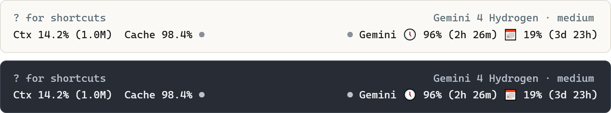

# Capsule CLI

[中文](./README.md) | **English**

A statusline for Antigravity CLI (`agy`) that is **fully customizable**: choose what to show, what to hide, and how it's colored.



## 👉 [Open the Web Configurator and make it yours](https://lumidarin.github.io/agy-capsule-cli/)

Click any item in the preview to toggle it, then copy the generated `/capsule-guide ...` command and send it to your agent.

## Install

Requires Node.js 22.13+ and AGY CLI. Send this in `agy` to let the agent install it:

```text
Please follow https://github.com/Lumidarin/agy-capsule-cli/blob/main/docs/install.md#english to install agy-capsule-cli for me.
```

Or manually:

```sh
git clone https://github.com/Lumidarin/agy-capsule-cli.git ~/agy-capsule-cli
cd ~/agy-capsule-cli
node cli/install.mjs
```

Restart `agy` afterwards. To update, pull and re-run `node cli/install.mjs` (settings are kept); to uninstall, run `node cli/install.mjs uninstall`.

## Customize

- **Web Configurator**: the easiest way, see above.
- **Natural language**: `/capsule-guide compact mode`, `/capsule-guide hide icons and weekly reset`.
- **CLI**: `node ~/.gemini/config/agy-capsule/cli/settings.mjs show | mode | enable | disable | reset`.
- **Edit** `~/.gemini/config/agy-capsule/cli/settings.json` directly.

Adjustable: standard/compact presets, 12 independent visibility toggles, text color, and alert styles for Ctx / Cache / quota. See the [Web Configurator](https://lumidarin.github.io/agy-capsule-cli/) and the [capsule-guide skill](skills/capsule-guide/SKILL.md) for every field.

## Notes

Data comes only from the stdin payload AGY provides (Cache alerts also read a timestamp from the local session SQLite, read-only). No network, no message text. Verified on Windows + AGY CLI 1.5.10; other platforms are untested.

[Installation Guide](docs/install.md#english) · [MIT License](LICENSE)
