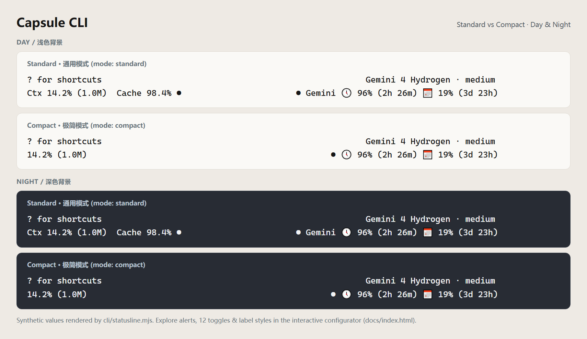

# Capsule CLI

**中文** | [English](./README.en.md)

**Experimental · 0.1.0-experimental.1**

给 Antigravity CLI (`agy`) 的简洁 statusline：左侧 Context、Cache hit，右侧当前模型组额度；支持**通用 (`standard`) / 极简 (`compact`)** 预设切换、**10 项显隐开关 + 4 项中英／图标前缀样式**（`Ctx`/`上下文`/无、`Cache`/`缓存`/无、`🕔`/`5h`/`5小时`/无、`📅`/`w`/`周`/无）与**独立提醒样式**。独立于桌面版 [agy-capsule](https://github.com/Lumidarin/agy-capsule)，不需要桌面 App 运行。

> **可视化配置页（GitHub Pages）**：打开 [在线配置器](https://lumidarin.github.io/agy-capsule-cli/)（或本地打开 [docs/index.html](docs/index.html)），勾选想要的每一项并实时预览日／夜效果，**一键复制 `/capsule-guide ...` 指令发给 Agent 生效**。



上图展示浅色／深色背景下通用与极简两种默认效果（模拟数值，非终端截图）。想查看黄／红告警、不同模型组、窄终端及 12 项开关的组合效果，请直接打开 [交互配置页](https://lumidarin.github.io/agy-capsule-cli/)。

## 安装与更新

需要 **Node.js 22.13+** 和 AGY CLI；Windows 的 `node` 必须能从 PATH 找到。已验证 Windows、Node 22.23.2、AGY CLI 1.5.10；macOS/Linux/WSL 尚未实机验证。

### 让 AI 代装（推荐）

在 Antigravity (`agy`) 中把下面这句话发给它，即可自动拉取最新代码并安装 statusline 与 `/capsule-guide` skill：

```text
请按 https://github.com/Lumidarin/agy-capsule-cli/blob/main/docs/install.md 帮我安装 agy-capsule-cli。
```

完整安装说明与给 AI 助手的操作约束见 [安装指南](docs/install.md#中文)。完成后**重启 `agy`** 即可生效（已有会话可先执行 `/skills reload` 加载 `/capsule-guide`）。

### 手动安装

克隆或下载源码，进入项目目录后运行：

```sh
git clone https://github.com/Lumidarin/agy-capsule-cli.git ~/agy-capsule-cli
cd ~/agy-capsule-cli
node cli/install.mjs
```

没有第三方运行依赖，不需要 `npm install` 或构建。默认同时安装 statusline 与 `/capsule-guide` agent skill；如果不想注册 skill，可传 `--no-skill`（或运行 `npm run setup:no-skill`）：

```sh
node cli/install.mjs --no-skill
```

更新时拉取新版源码并再次运行 `node cli/install.mjs`，原有显示偏好自动保留。

> 这不是 `agy plugin install` 格式的包，也没有发布到 npm；当前通过本地 installer 接入官方 statusline command。

## 显示模式与布局

**通用模式（`standard`，默认）：**

```text
? for shortcuts                                      Gemini 4 Hydrogen · medium
Ctx 14.2% (1.0M)  Cache 98.4% ●       ● Gemini 🕔 96% (2h 26m) 📅 19% (3d 23h)
```

**极简模式（`compact`）：**

```text
? for shortcuts                                      Gemini 4 Hydrogen · medium
14.2% (1.0M)                                 ● 🕔 96% (2h 26m) 📅 19% (3d 23h)
```

- 第一行保留模型、推理档位和简化的快捷键提示；第二行才是单行指标。**不是整个底栏只有一行。**
- 关闭原生默认行的叠加（`stack_with_default: false`），由我们重画模型行，因此不显示原生 AI Credits。
- `Ctx` 为宿主上报的 Context 使用率，括号为窗口容量；K/M 采用十进制缩写。
- `Cache` 为最近一份请求记录的 `cache_read_input_tokens / (input_tokens + cache_read_input_tokens)`，不是整段会话累计命中率。关闭 `show.cache`（或切换到 `compact` 模式）时不会查询本地会话 SQLite。
- 额度只取当前识别的模型组：Gemini、Claude、或具有独立周池的 Argon。5h 与周额度、各自前缀（`🕔`/`5h`/`5小时`/无 与 `📅`/`w`/`周`/无）及各自重置倒计时均可独立开关或调整。第三方池在 Claude 模型下标作 Claude；当前没有 GPT 模型映射，不能把所有第三方模型都说成已支持。
- 窄终端依次减少状态、倒计时等细节，尽量保持指标一行；极窄时截短。图标与中文宽度仍受终端字体影响。
- 缺失值显示 `--`；停用的 bucket 隐藏，真实 0% 保留。重置时间已过但 payload 未更新时显示 `(due)`，不擅自恢复到 100%。

## 本地设置：可视化配置、模式与逐项开关

所有设置保存在 `~/.gemini/config/agy-capsule/cli/settings.json`，在宿主下一次刷新时生效（没有独立 timer，空闲时不保证立即更新）。

### 1. 预设模式（`mode`）与逐项显隐开关（`show.*`）

先选择 `standard`（通用）或 `compact`（极简）预设，再按需覆盖任意单项的显示或隐藏：

| 位置 | 显示项 | 开关 key (`show.*`) | `standard` | `compact` | 说明 |
| --- | --- | --- | --- | --- | --- |
| 左侧 | Context 区块 | `context` | 开 | 开 | 整个 Context 区块（关闭时一并隐藏前缀与容量） |
| 左侧 | 窗口容量 | `capacity` | 开 | 开 | 括号内的窗口大小 `(1.0M)` |
| 左侧 | Cache 区块 | `cache` | 开 | 关 | 缓存命中率区块；关闭时跳过 SQLite 查询 |
| 左侧 | Agent 状态 | `state` | 开 | 关 | 非 idle 时的 `\| working`、`\| tool_use` |
| 右侧 | 额度区块总开关 | `quota` | 开 | 开 | 右侧当前模型组额度 |
| 右侧 | 额度组名 | `quotaGroup` | 开 | 关 | `Gemini` / `Claude` / `Argon` |
| 右侧 | 5 小时额度 | `quota5h` | 开 | 开 | 单独开关 5h 额度项 |
| 右侧 | 周额度 | `quotaWeekly` | 开 | 开 | 单独开关周额度项 |
| 右侧 | 5 小时重置倒计时 | `reset5h` | 开 | 开 | 单独开关 5h 的 `(2h 26m)` |
| 右侧 | 周重置倒计时 | `resetWeekly` | 开 | 开 | 单独开关周额度的 `(3d 23h)` |

> 快捷别名与兼容：`reset` 可同时开关 `reset5h` 与 `resetWeekly`；旧版 `"compact": true` 与 `"show": { "reset": false }` 均继续兼容。

### 2. 前缀标识样式（中英 / 图标 / 关闭）

| JSON key | 可选样式 | 默认（`standard` / `compact`） |
| --- | --- | --- |
| `contextLabel` | `en`（`Ctx`）· `zh`（`上下文`）· `off`（不显示） | `en` / `off` |
| `cacheLabel` | `en`（`Cache`）· `zh`（`缓存`）· `off`（不显示） | `en` / `off` |
| `quota5hLabel` | `icon`（`🕔`）· `short`（`5h`）· `zh`（`5小时`）· `off` | `icon` |
| `quotaWeeklyLabel` | `icon`（`📅`）· `short`（`w`）· `zh`（`周`）· `off` | `icon` |

命令行里可用 `quotaLabel` 一次同时设置 5h 与周前缀，例如 `set contextLabel zh cacheLabel zh quotaLabel zh` 可一键切换全中文前缀（`上下文 14.2% (1.0M)  缓存 98.4% ● ... ● Gemini 5小时 96% 周 19%`）。

### 3. 正文颜色（`textColor`）与提醒样式

| 设置项 | JSON key | 可选模式 | 默认 |
| --- | --- | --- | --- |
| 正文与模型行颜色 | `textColor` | `inherit` 跟随当前终端／color scheme 正文色（浅色即默认黑）、`muted` 模型行与中性圆点柔灰、`plain` 纯文本无 ANSI | `inherit` |
| Ctx 提醒 | `context` | `text` 文字变色、`off` 不提醒 | `text` |
| Cache 提醒 | `cache` | `text`、`dot` 圆点变色、`off` | `dot` |
| 额度提醒 | `quota` | `text`、`dot`、`off` | `dot` |

`off` 只关闭颜色提醒，不隐藏数值；若要隐藏整项，请使用 `disable` 或 `show.<item> off`。

### 4. 三种修改方式

**方式 A：可视化配置页 + `/capsule-guide`（最直观）**

打开 [在线配置器](https://lumidarin.github.io/agy-capsule-cli/) 勾选你想要的状态，点击「一键复制发给 Agent」，粘贴回 AGY 对话发送即可；也可以直接在 AGY 中用自然语言调用 `/capsule-guide`：

```text
/capsule-guide
/capsule-guide 极简模式
/capsule-guide 图标换成 5h 和 w，关掉周倒计时
/capsule-guide 极简模式但保留 Cache 且隐藏 Cache 前缀
/capsule-guide reset
```

**方式 B：命令行直接修改（无需模型）**

```sh
# 查看当前生效设置（只读）
node "$HOME/.gemini/config/agy-capsule/cli/settings.mjs" show

# 切换预设模式（重置 show 覆写，保留提醒与前缀样式）
node "$HOME/.gemini/config/agy-capsule/cli/settings.mjs" mode compact
node "$HOME/.gemini/config/agy-capsule/cli/settings.mjs" mode standard

# 逐项开启或隐藏（支持驼峰或短横线）
node "$HOME/.gemini/config/agy-capsule/cli/settings.mjs" enable cache
node "$HOME/.gemini/config/agy-capsule/cli/settings.mjs" disable cacheLabel resetWeekly quotaGroup

# 修改额度前缀样式（icon / short / zh / off）
node "$HOME/.gemini/config/agy-capsule/cli/settings.mjs" set quota5hLabel short quotaWeeklyLabel short
node "$HOME/.gemini/config/agy-capsule/cli/settings.mjs" set quotaLabel zh

# 一条命令组合修改
node "$HOME/.gemini/config/agy-capsule/cli/settings.mjs" set mode compact show.cache on show.cacheLabel off show.resetWeekly off quotaLabel short

# 恢复全部默认设置
node "$HOME/.gemini/config/agy-capsule/cli/settings.mjs" reset
```

**方式 C：直接编辑 `settings.json`**

编辑 `~/.gemini/config/agy-capsule/cli/settings.json`，`show` 只需写与当前 `mode` 预设不同的覆写项：

```json
{
  "mode": "compact",
  "context": "text",
  "cache": "dot",
  "quota": "dot",
  "quota5hLabel": "short",
  "quotaWeeklyLabel": "short",
  "show": {
    "cache": true,
    "resetWeekly": false
  }
}
```

### 变色规则

| 项目 | 黄色 | 红色 |
| --- | --- | --- |
| Ctx 使用率 | ≥75% | ≥90% |
| Cache 距最近模型回复完成 | ≥3 分钟 | ≥4 分钟 |
| 额度剩余（四舍五入后的百分比） | ≤25% | ≤10% |

Cache 圆点在百分比右边。额度共用一个圆点，在额度区块左边，且只反映当前可见窗口：**周额度红时优先红，否则跟随 5h**。周额度黄不覆盖 5h；只有周池可见时，非红色为中性色。额度 `text` 模式分别给可见的百分比变色。

Cache 的时间提醒**不证明服务端缓存已过期**，命中率本身低也不会触发这个时间提醒。读取不到回复时间时保持中性色。设置环境变量 `NO_COLOR` 或直接运行 renderer 时传 `--plain` 可以关闭全部 ANSI 颜色。

日／夜可读性：浅色背景保留深黄／深红，深色背景使用亮黄／浅红，模型提示文字也相应调整。AGY 选择 `terminal` 时，Windows 上随系统应用深浅主题在下一次 statusline 刷新时更新（适用于终端也跟随系统的配置）；显式的 AGY 浅／深主题优先。其他系统尝试 `COLORFGBG`，无信号时保持浅色方案。

## 数据从哪里来

- Context、Cache hit、模型、额度与 reset 来自 AGY 每次通过 **stdin JSON payload** 传入的数据。见 [AGY statusline 文档](https://antigravity.google/docs/cli/statusline/)。
- 仅在开启 Cache 显示且未关闭 Cache 提醒时，补充读取本机当前会话 SQLite：`~/.gemini/antigravity-cli/conversations/<conversation_id>.db`，以只读方式查询最后一个已完成模型回复的 metadata 时间戳。不会读取消息正文，不用文件 mtime 冒充回复时间。
- SQLite 的 `steps` 表、状态值、protobuf 字段是 **AGY 1.5.10 实测的内部结构**，并非稳定公开 API；结构变化或 DB 不可读会使时间提醒失效，其他 payload 指标继续显示。
- Renderer 不请求网络、RPC，不启动 `/usage`，不保存原始 payload。额度新鲜度取决于宿主传来的数据。
- 不提供 TTFT、tok/s、Think/Write 拆分；当前没有可靠数据依据。

## 安装位置与卸载

| 路径（`~` 为当前用户 home） | 用途 |
| --- | --- |
| `~/.gemini/config/agy-capsule/cli/` | Renderer、settings helper、显示偏好、原 statusline 备份 |
| `~/.gemini/antigravity-cli/settings.json` | 只修改 `statusLine`，保留其他设置 |
| `~/.gemini/skills/capsule-guide/SKILL.md` | 默认安装的 `/capsule-guide` 配置向导 skill（传 `--no-skill` 可跳过；不覆盖已有无关同名 skill） |

卸载 renderer 并恢复安装前的 statusline：

```sh
node cli/install.mjs uninstall
```

重复安装保留原备份。若用户后来选择了其他 renderer，卸载不覆盖新选择。显示偏好和 `/capsule-guide` skill 会保留，便于重装。桌面版配置不受影响。

## 开发与验证

```sh
node --test test/*.test.mjs
node scripts/preview.mjs
```

测试覆盖：真实脱敏 payload、缺失／零额度、模型组、窄窗口、重置时间、18 种提醒组合、通用／极简预设、12 项独立显隐开关、5h／周额度独立开关与前缀样式（含中文宽度对齐）、旧版配置兼容迁移、日夜主题切换与颜色对比度、只读 SQLite 时间、安装恢复、带空格路径、设置修改及 `/capsule-guide` skill 安装与冲突保护。Preview 命令重建 `docs/preview.html`；PNG 是该页面的浏览器截图。

没有依赖安装步骤，暂不需要 lockfile。项目包标为 `private`，防止误发 npm；不影响 GitHub 源码发布。

[安装指南](docs/install.md) · [在线配置器](https://lumidarin.github.io/agy-capsule-cli/) · [同类项目调研（2026-11-17）](docs/related-projects.md) · [MIT License](LICENSE)
